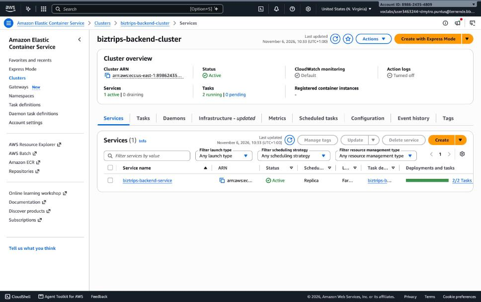
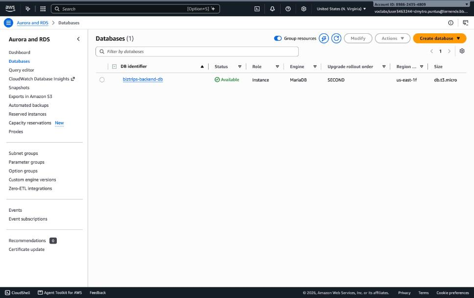
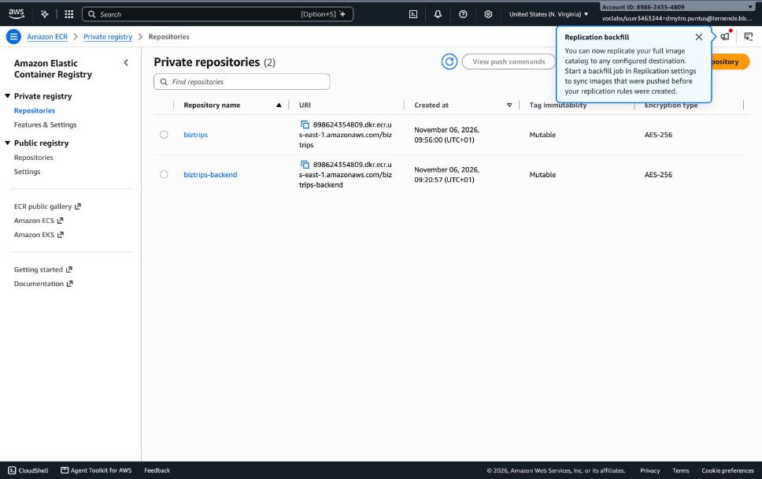
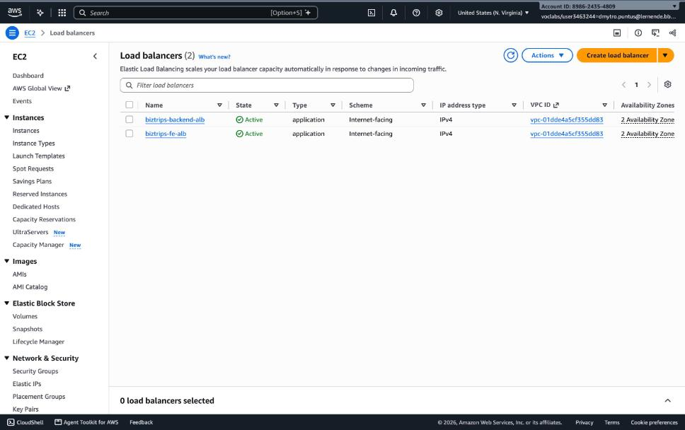
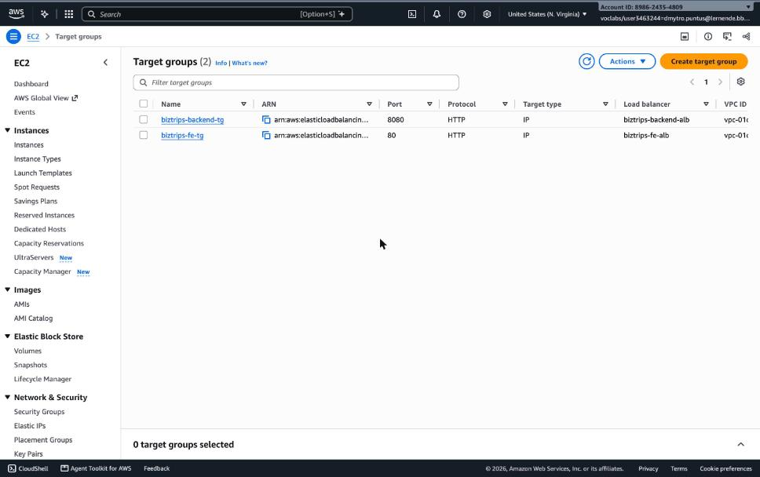
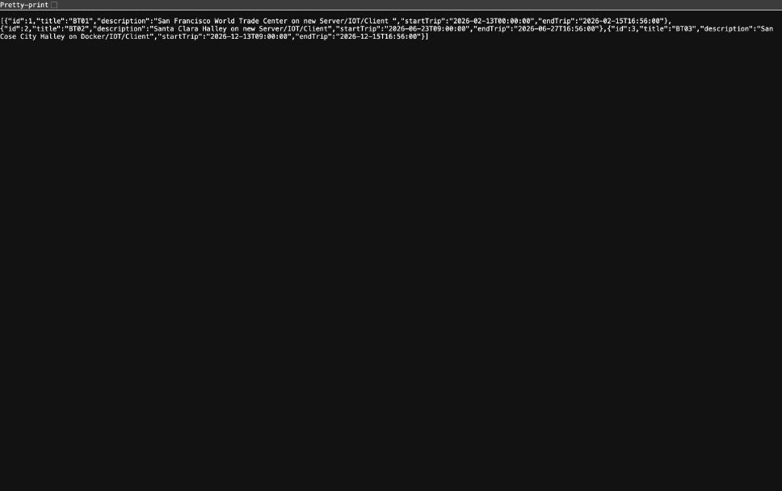
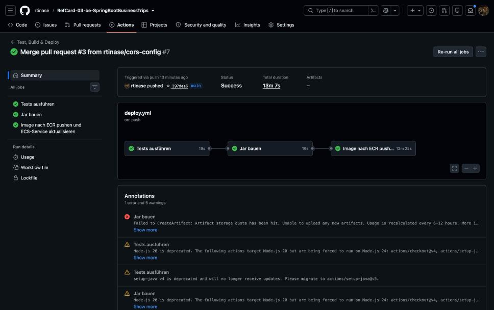
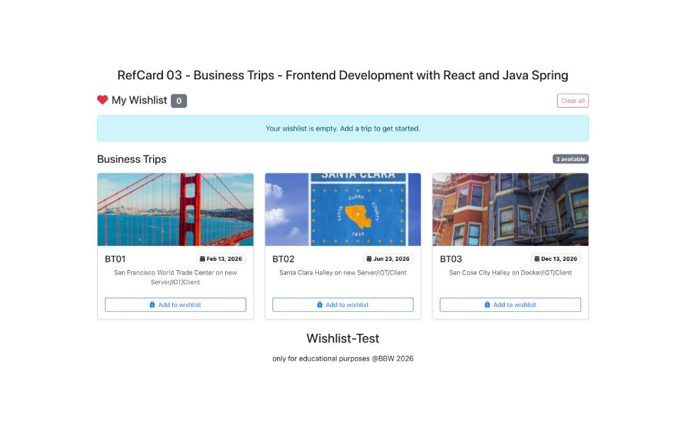

# RefCard 03/04 – Backend: EX-03 (ECS Fargate) und EX-04 (Foto-Storage)

Repository: <https://github.com/rtinase/RefCard-03-be-SpringBootBusinessTrips>
Frontend-Repository: <https://github.com/rtinase/refcard-03-fe-react-vite>
Umgebung: AWS Academy Learner Lab, Region `us-east-1`, Account `898624354809`

| Komponente | URL |
| --- | --- |
| Backend (ECS Fargate hinter ALB) | `http://biztrips-backend-alb-1126669786.us-east-1.elb.amazonaws.com/v1/trips` |
| Health-Check | `http://biztrips-backend-alb-1126669786.us-east-1.elb.amazonaws.com/actuator/health` |
| Frontend (ECS Fargate hinter ALB) | `http://biztrips-fe-alb-613393037.us-east-1.elb.amazonaws.com/` |
| EX-04 Backend auf EC2 | `http://ec2-54-146-203-246.compute-1.amazonaws.com:8080/v1/employees/1/photo` |

---

## EX-03 – Deployment auf AWS ECS (Fargate) mit RDS

### Architektur

```
Browser → ALB (Port 80) → ECS-Service (2 Fargate-Tasks, Port 8080) → RDS MariaDB (Port 3306)
                                   ↑ Image aus ECR, DB-Passwort aus Secrets Manager
```

Die Tasks sind zustandslos. Die Datenbank läuft auf **RDS** und nicht als Container, weil Fargate keinen
persistenten Storage hat. Das DB-Passwort steht nicht im Repository, sondern in **Secrets Manager** und wird
von ECS erst beim Task-Start als Umgebungsvariable eingespielt.

### Vorgehen (Kurzfassung)

1. **ECR-Repository** `biztrips-backend` anlegen.
2. **RDS** `biztrips-backend-db` (MariaDB 10.11, `db.t3.micro`, nicht öffentlich erreichbar) anlegen,
   Passwort als Secret `biztrips-backend-db-password` in Secrets Manager speichern.
3. **ECS-Cluster** `biztrips-backend-cluster` anlegen.
4. **Security Groups:**
   ALB (Port 80 aus dem Internet) → Tasks (Port 8080 nur von der ALB-SG) → RDS (Port 3306 nur von der Task-SG).
5. **Target Group** (Typ `ip`, Port 8080, Health-Check `/actuator/health`) und **Application Load Balancer**
   mit Listener Port 80.
6. **Task Definition** (`task-definition.json`): Rolle `LabRole`, Datenbank-URL als `environment`,
   Passwort über `secrets` aus Secrets Manager.
7. **ECS-Service** `biztrips-backend-service` mit `desired-count 2` (Fargate, Load Balancer angebunden).
8. **Pipeline** (`.github/workflows/deploy.yml`): `test` → `build` → `deploy-ecs`
   (Image bauen, nach ECR pushen, Task Definition aktualisieren, Service deployen, auf Stabilität warten).

### Pipeline auf eigenem Runner

Der GitHub-Account ist wegen eines Billing-Problems gesperrt, daher starten die von GitHub gehosteten Runner
nicht (`startup_failure`). Die Pipeline läuft deshalb auf einem **self-hosted Runner in einem lokalen
Docker-Container** (`myoung34/github-runner`, Label `local-docker`). Im Workflow steht
`runs-on: [self-hosted, local-docker]`. Die AWS-Zugangsdaten des Learner Labs liegen als GitHub Secrets
(`AWS_ACCESS_KEY_ID`, `AWS_SECRET_ACCESS_KEY`, `AWS_SESSION_TOKEN`); sie laufen mit der Lab-Sitzung ab.

### Stolpersteine, die aufgetreten sind

| Problem | Ursache | Lösung |
| --- | --- | --- |
| Service blieb bei 503, Tasks starteten nicht | Falscher Secret-ARN in der Task Definition (`ResourceNotFoundException`) | Richtigen ARN mit `aws secretsmanager describe-secret` auslesen, neue Task-Definition-Revision registrieren |
| Tasks wurden vom ALB als `unhealthy` markiert, bevor Spring Boot oben war | Spring Boot braucht auf 0.5 vCPU länger als das Health-Check-Fenster | `health-check-grace-period-seconds 240`, grosszügigere Health-Check-Schwellen |
| Image startet nicht auf Fargate (Gefahr) | Build auf Apple Silicon liefert `arm64`, Fargate läuft hier mit `x86_64` | `docker build --platform linux/amd64`, Build-Stage im `Dockerfile` mit `FROM --platform=$BUILDPLATFORM` |
| Frontend zeigte keine Daten | CORS: Backend erlaubte nur `localhost`-Origins | Origins über `app.cors.allowed-origins` / `APP_CORS_ALLOWED_ORIGINS` konfigurierbar gemacht, Frontend-ALB in der Task Definition erlaubt |
| Build-Job rot beim Artefakt-Upload | Artefakt-Speicherquota des Accounts erschöpft | `continue-on-error: true` beim Upload (der Deploy-Job braucht das Artefakt nicht) |

### Ergebnis (Screenshots)

**ECS-Service im Cluster `biztrips-backend-cluster`: 2 von 2 Tasks laufen**


**RDS-Instanz `biztrips-backend-db` (MariaDB) ist verfügbar**


**ECR-Repositories für Backend und Frontend**


**Application Load Balancer für Backend und Frontend**


**Target Groups (Typ IP, Backend Port 8080)**


**REST-API über den ALB (`/v1/trips`, Daten aus RDS)**


**Pipeline läuft auf dem lokalen Runner (Tests, Build, Deploy nach ECS)**


**Gesamtsystem: Frontend auf ECS lädt die Trips vom Backend auf ECS**


---

## EX-04 – Lokaler Datei-Storage für Mitarbeiterfotos

### Umsetzung

- `Employee.profilePictureFilename`: In der Datenbank steht **nur der Dateiname**, nicht das Bild.
- `application.properties`: `app.storage.location=./uploads`, Upload-Limit 5 MB.
  Der Pfad ist konfigurierbar (`APP_STORAGE_LOCATION`) und nicht im Code fest verdrahtet.
- `FileStorageService` (`ch.bbw.trips.storage`):
  - **Whitelist** der Typen (`image/png`, `image/jpeg`, `image/webp`);
  - **UUID** als Dateiname (keine Kollisionen, Dateiname des Clients wird nie verwendet);
  - **Schutz vor Path Traversal**: `normalize()` und Prüfung, dass der Zielpfad direkt unter `root` liegt.
- Endpoints `POST` und `GET /v1/employees/{id}/photo`; ungültige Dateien ergeben `400`, unbekannte Mitarbeitende `404`.
- Unit-Tests `FileStorageServiceTest` (Speichern, falscher Typ, leere Datei, Path Traversal).
- `Dockerfile`: `VOLUME ["/app/uploads"]` und `ENV APP_STORAGE_LOCATION=/app/uploads`.

### Deployment auf EC2 (Fotos überleben einen Redeploy)

Auf der Instanz läuft das Backend als systemd-Service. Der Upload-Ordner liegt **ausserhalb** des
Arbeitsverzeichnisses, aus dem `app.jar` gestartet wird:

```ini
# /etc/systemd/system/businesstrips.service (Ausschnitt)
User=ec2-user
Environment=APP_STORAGE_LOCATION=/opt/businesstrips/uploads
ExecStart=/usr/bin/java -jar /opt/businesstrips/app.jar --spring.profiles.active=mariadb
```

Ein Redeploy überschreibt nur `app.jar`, nicht `/opt/businesstrips/uploads`. Getestet: Foto hochgeladen,
Service neu gestartet (`systemctl restart businesstrips`), Foto war danach unverändert abrufbar.

**Hochgeladenes Foto, abgerufen von der EC2-Instanz (`GET /v1/employees/1/photo`)**


### Warum das nicht 1:1 nach ECS/Fargate passt

Auf ECS laufen mehrere gleichwertige Tasks (`desired-count 2`), jeder mit eigenem, flüchtigem
Container-Dateisystem. Ein Foto, das Task A speichert, sieht Task B nicht, und ein ersetzter oder neu
deployter Task startet leer. Ein benanntes Docker-Volume ist ausserdem an genau einen Host gebunden.
Dafür braucht es einen gemeinsamen Speicher: **S3** (RefCard 05). Der `FileStorageService` bleibt als
Konzept (`store(...)` → Referenz, `load(...)` → Resource) bestehen und bekommt dann eine S3-Implementierung.

---

## Aufräumen (Learner Lab hat ein Kostenlimit)

ECS-Services auf `desired-count 0` setzen und löschen, beide ALBs und Target Groups löschen, RDS-Instanz
(`--skip-final-snapshot`), ECR-Repositories, Secret und die EC2-Instanz entfernen. Die Befehle stehen in
[`exercises/EX-03-Checklist.md`](exercises/EX-03-Checklist.md) im Abschnitt «Aufräumen».
